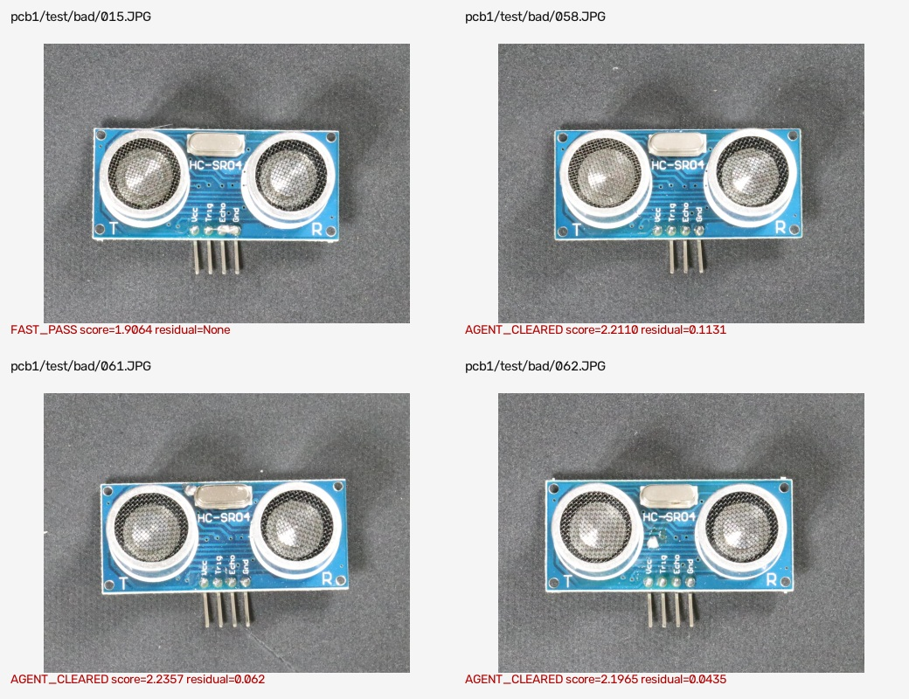

# Defect Escape Visual Evidence

All `4` cached defect escapes are shown below. These are known failures, not successful detections.

| Image | Decision path | Score | Residual | Evidence |
|---|---|---:|---:|---|
| `pcb1/test/bad/015.JPG` | `FAST_PASS` | 1.9064 | None | [annotated image](escape_evidence/015_escape.jpg) |
| `pcb1/test/bad/058.JPG` | `AGENT_CLEARED` | 2.2110 | 0.1131 | [annotated image](escape_evidence/058_escape.jpg) |
| `pcb1/test/bad/061.JPG` | `AGENT_CLEARED` | 2.2357 | 0.062 | [annotated image](escape_evidence/061_escape.jpg) |
| `pcb1/test/bad/062.JPG` | `AGENT_CLEARED` | 2.1965 | 0.0435 | [annotated image](escape_evidence/062_escape.jpg) |

The source dataset is not redistributed in the submission archive. These derived review images are included solely to document failure behavior and must be removed if dataset licensing does not permit derived evaluation evidence.
