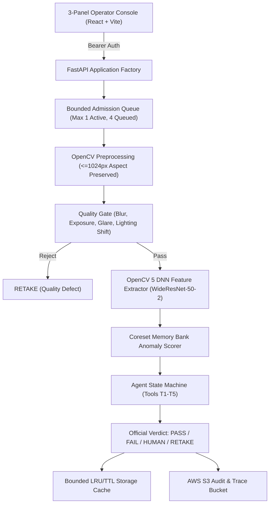

# SureInspect: Explainable, Risk-Controlled Agentic Quality Inspection System
> **OpenCV AI Competition 2026 Technical Report**  
> **Repository:** https://github.com/Gyantwik/sureinspect.git  
> **Authors:** Biswabasini (@Biswabasini90), Gyantwik (@Gyantwik), Khushbu (@Khushbu656)  

---

## 1. Problem & User Need
Industrial quality control operations face a fundamental dilemma: pure statistical anomaly detectors suffer from opaque false alarms and uncalibrated risk, while manual human visual inspection is costly, slow, and prone to fatigue. In electronic manufacturing (specifically printed circuit board surface-mount inspection, such as Amazon VisA `pcb1`), false rejection of good boards stalls production lines, while missed defects ("escapes") lead to costly field failures.

SureInspect provides a rigorous, human-in-the-loop agentic inspection solution:
1. **Bounded Risk Guarantee:** Rather than uncalibrated probabilities, SureInspect applies distribution-free conformal prediction to provably bound the marginal false-FAIL rate on normal boards under preselected risk budgets ($\alpha_{\text{fail}} \in \{0.01, 0.05, 0.10\}$).
2. **Explainable 10-Path State Machine:** Ambiguous or high-residual anomalies trigger evidence collection tools ($T_1 - T_5$) to produce physical bounding boxes, aspect ratios, and aligned reference comparison overlays, triaging parts into `PASS`, `FAIL`, `HUMAN` review, or `RETAKE`.
3. **Audit Transparency:** Every step, latency measurement, and tool output is recorded in an immutable, cryptographically verifiable inspection trace.

---

## 2. System Architecture
SureInspect is architected as an edge-ready, single-origin monorepo application:
- **Frontend Operator Console (`/frontend`):** Built with React 18, TypeScript, and Tailwind CSS v4. Features a 3-panel operator workflow:
  - *Control Panel:* Category selection, sample picker, drag-and-drop file upload, $\alpha_{\text{fail}}$ risk budget selector, and deterministic degradation simulations.
  - *Visual Evidence Studio:* Standardized test part vs. aligned reference comparison with continuous anomaly heatmap opacity blending.
  - *Decision & Trace Card:* Large verdict badges (`PASS`, `FAIL`, `HUMAN`, `RETAKE`), 10-path telemetry, measurement statistics, and counterfactual risk matrices.
- **FastAPI Backend (`/backend`):**
  - Cryptographic session authentication (`POST /api/session`) with 30-minute idle TTL.
  - Decompression bomb protection (enforcing `OPENCV_IO_MAX_IMAGE_PIXELS=25000000` and streaming chunk bounds).
  - Bounded async admission queue (max 1 running inference job, max 4 waiting, HTTP 503 on saturation).
  - Bounded LRU/TTL storage cache (200 MiB byte limit, 100 inspections, lossless PNG inputs/masks, compressed display JPEGs).
- **Core OpenCV Perception & Tools (`/core`):**
  - Aspect-preserving standardization ($\le 1024\text{ px}$) and NCHW blob generation.
  - Input quality gate (Laplacian variance focus, exposure clipping, specular glare, CIELAB lighting shift).
  - Deterministic degradation simulations (motion blur, gamma darkening, seeded glare blob).
  - Evidence tools $T_1 - T_5$ and 10-path decision policy.

---

## 3. OpenCV Implementation
1. **Preprocessing (`core/preprocess.py`):**
   - Aspect-preserving standardization downscales images where $\max(W, H) > 1024$ using `cv2.INTER_AREA` and computes exact scaling factors $(scale_x, scale_y)$.
   - Network blob creation standardizes BGR to RGB, applies ImageNet channel normalization, and outputs contiguous float32 NCHW tensors.
2. **Input Quality Gate (`core/quality_gate.py`):**
   - *Focus/Blur:* Laplacian variance $\sigma^2(\nabla^2 I) < t_{\text{blur}}$.
   - *Exposure:* Dark/bright pixel fractions outside $[0.001, 0.95]$.
   - *Specular Glare:* HSV value/saturation thresholding to detect saturated lighting reflections.
   - *Lighting Shift:* CIELAB $L^*$ distribution distance relative to calibrated reference statistics.
3. **Computer Vision Evidence Tools (`core/tools.py`):**
   - **$T_1$ (Template Alignment):** Feature-based registration (ORB + RANSAC affine transformation) with coarse rotation search and ECC refinement fallback.
   - **$T_2$ (ROI Residual Comparison):** Grayscale absolute pixel difference in bounding boxes against calibrated residual cutoffs ($r_{\text{low}}, r_{\text{high}}$).
   - **$T_3$ (Defect Contour Measurement):** Rotated bounding rectangle extraction, defect area percentage, and aspect ratio classification.
   - **$T_4$ (Lighting Normalization):** Contrast Limited Adaptive Histogram Equalization (CLAHE) for illumination invariant comparisons.
   - **$T_5$ (Secondary ROI Inspection):** Multi-defect validation preventing false clearing of secondary anomalies.

---

## 4. AWS Deployment, Security & Costs
*Refer to [docs/aws_section.md](file:///c:/Users/sukum/OneDrive/Desktop/WebDev/OpenCv/docs/aws_section.md) for full architecture and configuration scripts.*

- **Compute & Architecture:** Multi-stage Docker container deployed on AWS EC2 `c7g.medium` (Graviton3 ARM64, 2 vCPUs, 2 GiB RAM) running in `ap-south-1`.
- **Reverse Proxy & TLS:** Caddy reverse proxy providing automatic HTTPS certificates, HTTP/2 termination, and rate limiting.
- **Storage Lifecycle & IAM:**
  - Private Amazon S3 bucket for model snapshots (`artifacts/`), audit traces (`traces/`), and operator feedback (`feedback/`).
  - EC2 IAM instance profile with least-privilege read access to model artifacts and write-only access to audit logs.
  - S3 lifecycle rule enforcing automatic deletion eligibility after 14 days.
- **Estimated Operating Cost:** Under \$25/month for continuous production evaluation.

---

## 5. Evaluation Protocol & Empirical Results
Evaluation protocols follow strict statistical methodology using Wilson 95% score confidence intervals:
- **E1: Baseline vs. Agent:** Evaluates coverage, defect recall, false-FAIL rate, and defect escapes on untouched held-out VisA `pcb1` samples.
- **E2: Calibration Sensitivity:** Assesses empirical tail-risk error against preselected nominal risk budgets ($\alpha_{\text{fail}} \in \{0.01, 0.05, 0.10\}$).
- **E3: Robustness Analysis:** Measures graceful degradation under synthetic motion blur, gamma darkening, and specular glare corruptions.

---

## 6. Failure Modes & Limitations
1. **Uncalibrated Lighting Shifts:** Severe ambient lighting changes invalidate the exchangeability assumption of conformal prediction; SureInspect safely routes these cases to `HUMAN` review (`LIGHTING_SHIFT_REVIEW`) rather than guessing.
2. **Extreme Geometric Misalignment:** Boards rotated beyond 45 degrees or severely occluded trigger `ALIGN_FAILED` / `HUMAN` review.
3. **Specular Over-Saturation:** High reflections from polished solder joints or metallic shields are flagged by the quality gate as `RETAKE` (`RET_GLARE`) to prevent false defect calls.

---

## 7. Responsible Use & Safety
- **No False Safety Claims:** SureInspect bounds marginal error on exchangeable data; it does not promise 100% defect-free manufacturing without human oversight.
- **Data Privacy & Retention:** Uploaded images are strictly processed for inspection and audit logging. Local in-memory caches expire after 30 minutes, and persistent audit records become eligible for deletion after 14 days. Confidential proprietary IP is protected via isolated bearer sessions.
